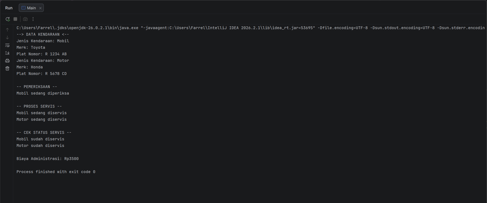

# SistemOtomotifPBO

## Identitas
- Nama: Farrel Nadhif Athallah
- NIM: H1D025048
- Tema: Otomotif

## Deskripsi
Program ini Saya buat dengan tema otomotif dan menggunakan java. Program digunakan untuk menampilkan informasi kendaraan mobil dan motor, melakukan pemeriksaan, serta melakukan servis kendaraan.

## File Program
- Kendaraan.java
- Mobil.java
- Motor.java
- BisaDiservis.java
- BisaDiperiksa.java
- Main.java

## Cara Menjalankan Program

**Melalui Terminal:**

1. Buka folder SistemOtomotifPBO melalui terminal.
2. Compile semua file Java:

```bash
javac *.java
```

3. Jalankan program:

```bash
java Main
```

**Melalui IntelliJ IDEA:**

1. Buka project SistemOtomotifPBO.
2. Buka file Main.java.
3. Klik kanan, lalu pilih Run 'Main.main()'.
4. Hasil program akan muncul pada jendela Run.

## Screenshot Hasil Program

Berikut adalah hasil program saat berhasil dijalankan.

